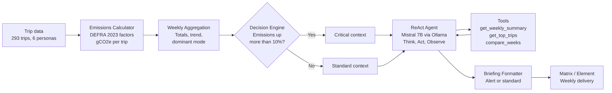

# Carbon Footprint AI Assistant

**An Agentic AI pipeline that calculates transport CO2 emissions, reasons over weekly trends with a local LLM (Mistral 7B via Ollama) and automatically delivers personalised sustainability briefings to Matrix/Element. Fully local, no external AI APIs.**


Developed as part of the **Erasmus BIP "Agentic AI Solutions for Sustainable Innovation"** at **Hochschule Heilbronn**.

---

## At a Glance

| | |
|---|---|
| Pipeline | **14-node n8n workflow**, from raw trip data to a delivered weekly briefing |
| AI | **ReAct agent** (Think, Act, Observe) on **Mistral 7B**, running locally via **Ollama** |
| Agent tools | `get_weekly_summary`, `get_top_trips`, `compare_weeks` (max. 6 reasoning steps) |
| Emission factors | **DEFRA 2023** (UK government), 15 transport modes in gCO2e per passenger-km |
| Dataset | **293 trips**, **6 commuter personas**, **4 weeks**, 6 transport modes |
| Alert logic | **Critical** briefing if weekly emissions rise **more than 10%**, otherwise Standard |
| Quality checks | **33 automated pipeline checks** + an evaluation script that traces every number in the AI output back to real data |

---

## The Problem

Most carbon calculators show a number and stop there. People don't change their behaviour because of a number: they need to know **what changed, why, and what to do next**, delivered where they already are.

This project automates that full loop: calculate emissions, detect trends, let an AI agent **investigate the data on its own**, and deliver concrete, data-grounded recommendations every week.

---

## Architecture



### How it works

1. **Emissions Calculator:** every trip is converted to gCO2e with official DEFRA 2023 factors (for example car 170, bus 89, train 35.7, bicycle 0 gCO2e per km).
2. **Weekly Aggregation:** total emissions per week, emissions per transport mode, the dominant mode and the week-over-week change.
3. **Decision Engine:** if emissions rose more than 10%, the workflow switches to the **Critical** path (urgent, direct tone). Otherwise it uses the **Standard** path.
4. **ReAct Agent:** instead of writing a generic text, Mistral 7B **decides which data to look at**. It calls tools, observes the results and reasons again, up to 6 steps, before writing its final recommendations.
5. **Briefing Formatter:** builds either an alert or a standard briefing with totals, trend, main emission source and recommendations.
6. **Matrix/Element delivery:** the briefing is posted automatically to a Matrix room.

---

## Example: How the Pipeline Reacts

Real output from the weekly aggregation on the sample dataset (calendar weeks of the data, January 2024):

| Week | Total CO2e | Change | Trend | Main source | Path |
|---|---|---|---|---|---|
| 2 | 60,724 g | baseline | first week | Car (58%) | Standard |
| 3 | 87,867 g | **+44.7%** | increasing | Car (77%) | ⚠️ **Critical** |
| 4 | 60,381 g | -31.3% | decreasing | Car (58%) | Standard |
| 5 | 61,746 g | +2.3% | stable | Car (58%) | Standard |

In week 3, car use jumped to 77% of emissions, so the pipeline switched to the **Critical** path and the agent focused on the single most impactful action.

### Example briefing structure (Critical path)

```
⚠️ EMISSIONS ALERT, Week 3

Emissions rose 44.7% this week, action recommended.

Total:       87,867 gCO₂e
▲ Up 44.7% from last week  (prev: 60,724 gCO₂e)
Main source: Car (77% of emissions)

📋 Priority Actions:
[Recommendations generated by the ReAct agent,
 grounded in the user's own trips and CO2e numbers]

Carbon Footprint AI Assistant | DEFRA 2023 factors
```

---

## Trustworthy AI: No Invented Numbers

LLMs can hallucinate figures. This project checks for that explicitly:

- **`evaluate_recommendations.py`** extracts every number from the AI's recommendations and traces it back to a real source: pipeline output, raw trip records, weekly totals, DEFRA factors, mode percentages or derived values (for example the CO2e of the same trip by train).
- **`verify_pipeline.py`** runs **33 automated checks** on data, calculations, aggregation and branching before a demo.
- **Fallback logic:** if Ollama doesn't respond, the agent falls back to pre-written recommendations, so the weekly delivery never fails.

---

## Tech Stack

| Technology | Purpose |
|---|---|
| **Python** | Emissions calculation, aggregation, agent logic, evaluation |
| **n8n** | Workflow orchestration (14 nodes, Standard/Critical branching) |
| **Mistral 7B** | Recommendation generation |
| **Ollama** | Local LLM runtime, offline inference |
| **ReAct pattern** | Tool-using agent: Think, Act, Observe |
| **Matrix / Element** | Automated report delivery |
| **Docker** | Self-hosted deployment |
| **DEFRA 2023** | Official CO2e emission factors |

---

## Repository Structure

```
carbon-footprint-ai-assistant/
├── Carbon Footprint Pipeline (3).json   # n8n workflow export (14 nodes)
├── emissions_calculator.py              # Trip-level CO2e with DEFRA 2023 factors
├── aggregate.py                         # Weekly totals, trend and Standard/Critical decision
├── react_agent.py                       # ReAct agent with tools, Mistral via Ollama
├── matrix_sender.py                     # Briefing formatting and Matrix delivery
├── evaluate_recommendations.py          # Traces every AI-generated number to real data
├── verify_pipeline.py                   # 33 automated pipeline checks
├── emission_factors.json                # DEFRA 2023 factors (15 transport modes)
├── synthetic_data.csv                   # 293 trips, 6 personas, 4 weeks
├── architecture_carbon_footprint.png    # Architecture diagram
└── README.md
```

---

## How to Run

The scripts expect a `scripts/` and `data/` folder layout:

```bash
# 1. Clone and arrange the folders
git clone https://github.com/Mayureshp21/carbon-footprint-ai-assistant.git
cd carbon-footprint-ai-assistant
mkdir scripts data
mv *.py scripts/
mv synthetic_data.csv emission_factors.json data/

# 2. Install dependencies
pip install requests

# 3. Start the local LLM
ollama pull mistral
ollama serve

# 4. Run the pipeline steps
python scripts/aggregate.py          # weekly totals and Standard/Critical decisions
python scripts/react_agent.py        # ReAct agent investigation and recommendations
python scripts/verify_pipeline.py    # automated checks
```

For the full automation, import `Carbon Footprint Pipeline (3).json` into n8n and set your Matrix homeserver, room ID and access token.

---

## Future Improvements

- Google Maps Timeline integration for automatic trip tracking
- Private Matrix rooms for individual users
- LangGraph-based long-term agent memory
- Natural language trip logging ("I drove 15 km to work today")
- Mobile app for transport tracking
- Support for more national emission factor databases

---

## Team

**Erasmus BIP: Agentic AI Solutions for Sustainable Innovation**

- Mayuresh Parche ([LinkedIn](https://www.linkedin.com/in/mayureshparche/) | [GitHub](https://github.com/Mayureshp21))
- Alexia Seulean
- Sadeed Shanediwan
- Roberta Aschilean
- Ranitabh Mallick

---

## License

Developed for academic and educational purposes as part of the Erasmus Blended Intensive Programme (BIP).
